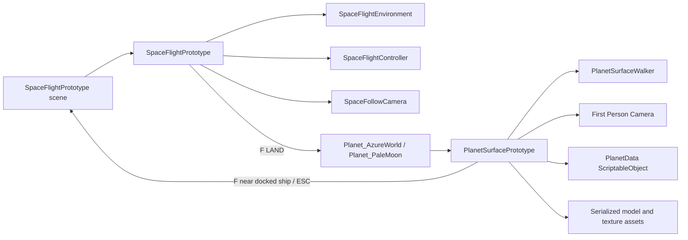
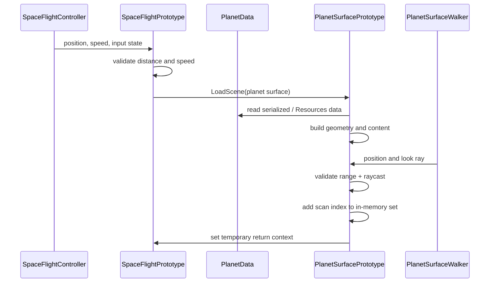

# Runtime Architecture

**Status:** Implemented prototype with production boundaries identified  
**Unity:** 6000.6.0f1  
**Target:** Windows and macOS desktop

## 1. Architectural intent

Game Frontier currently has two playable runtime slices:

- **Space flight:** a third-person ship playground with destinations, braking, camera orbit, and destination interaction.
- **Planet surface:** a first-person walking slice with generated island geometry, imported structures, scan targets, a docked ship, and a return-to-orbit action.

The project should keep these concerns separate. A scene is responsible for presenting and running one mode; data assets describe destinations and content; a future session layer should own durable player state. The current prototype uses scene loading as the transition boundary and temporary in-memory state as the session boundary.

## 2. Runtime ownership



### Current class responsibilities

| Component | Responsibility | Must not become responsible for |
| --- | --- | --- |
| `SpaceFlightPrototype` | Creates the flight runtime, chooses a destination, owns flight HUD and scene transition. | Ship physics details, authored planet content, permanent save data. |
| `SpaceFlightEnvironment` | Builds the procedural flight backdrop: stars, gate, planets, moon, station and orbital details. | Input, destination rules, surface mission logic. |
| `SpaceFlightController` | Reads flight input, applies acceleration/steering/braking and bounded movement through `CharacterController`. | Camera presentation, mission progression, scene loading. |
| `SpaceFollowCamera` | Third-person follow, right-mouse orbit, wheel zoom and obstruction handling. | Ship movement or destination selection. |
| `PlanetSurfacePrototype` | Builds the current surface blockout, places imported structures, creates scan markers, updates surface HUD and handles return. | General-purpose locomotion, durable progression, combat systems. |
| `PlanetSurfaceWalker` | First-person WASD movement, mouse look, gravity, jump, island boundary and interaction distance checks. | Mission results, scene transitions, UI copy. |
| `PlanetData` | Scriptable destination identity and presentation data: name, environment, colors, civilization level, landing availability and points of interest. | Runtime player state or generated geometry. |

The names and methods above are the current implementation contract. New code should depend on the smallest relevant component rather than reaching into the prototype orchestrators.

## 3. Scene and runtime generation model

The prototype scenes are intentionally minimal bootstrap scenes. The editor tools create or open the scene and register it in the active build profile; most visible objects are created in `Start` during Play Mode.

### Flight startup

1. `SpaceFlightPrototype.Start` creates `SpaceFlightEnvironment` and calls `Build()`.
2. A player ship is created with `SpaceFlightController` and primitive visual parts.
3. A camera with `SpaceFollowCamera` follows the ship.
4. The runtime HUD is created and a destination is selected.
5. If the surface scene set return context, the ship is placed near the selected destination; otherwise it starts at the departure point.

### Surface startup

1. `PlanetSurfacePrototype.Start` resolves `PlanetData` from the serialized field or `Resources/Planets/AzureWorld`.
2. `BuildSurface()` creates the island, water observation surface, shoreline, imported structures, landing area, docked ship and scan markers.
3. A `CharacterController` and `PlanetSurfaceWalker` are created for the explorer.
4. A child camera provides first-person look and the runtime HUD reports mission and scan state.

This arrangement is useful for a fast prototype because an empty scene can be rebuilt consistently. It has a known production cost: generated objects cannot be authored, lit, occluded, or reviewed in the editor as ordinary scene content. The migration path is to retain the orchestrator as a composition root while moving stable content into prefabs and authored scene chunks.

## 4. Flight, landing and surface boundaries

### Current transition

The flight scene measures distance to the selected destination and requires the ship to be close and moving below the interaction speed before accepting `F`. Azure World and Pale Moon load their surface scenes directly. The surface scene sets two temporary static values on `PlanetSurfacePrototype`:

- `ReturnTargetIndex`: which flight destination to select on return.
- `ReturningFromSurface`: whether to spawn near that destination instead of departure.

The surface scene returns by approaching the generated docked ship and pressing `F`, or by pressing `Escape`.

### Production boundary

The future implementation should replace static transition flags with a small serializable transition payload owned by a session service:

```text
SurfaceTransitionContext
  planetId
  departurePosition / departureRotation
  approachVelocity
  playerLocationId
  missionSnapshot
  cameraMode
```

`SpaceFlightPrototype` and `PlanetSurfacePrototype` should consume this context, but neither should own save/load policy. A later landing sequence can insert a `LandingTransitionController` between the flight mode and surface mode without changing ship physics or walking code.

## 5. Data and state flow

### Current data flow



The discovery set is currently a per-Play-session `HashSet<int>`. It is suitable for validating the interaction loop but is not a save format. The production version should use stable IDs (`planetId`, `pointOfInterestId`) instead of list indices so that content ordering can change without invalidating progress.

### Recommended state layers

| Layer | Lifetime | Example contents |
| --- | --- | --- |
| Presentation state | One scene | HUD text, camera FOV, scan marker pulse. |
| Mode state | One mode/session | Current flight target, ship transform, explorer transform, local scan results. |
| Session state | One play session | Current planet, fuel/telemetry, completed scans, mission status. |
| Save state | Across launches | Player profile, discovered locations, unlocked planets, settings. |

The first production refactor should introduce `GameSessionState` plus `PlanetExplorationState` as plain serializable data. Keep `PlanetData` immutable design data and keep runtime progress out of ScriptableObjects.

## 6. Input and camera contracts

The current prototype uses Unity's Input System device APIs directly (`Keyboard.current`, `Mouse.current`). This is acceptable for a test slice but couples gameplay code to devices.

### Current controls

| Mode | Input | Owner | Result |
| --- | --- | --- | --- |
| Flight | W/S | `SpaceFlightController` | Thrust/reverse. |
| Flight | A/D, Up/Down, Q/E | `SpaceFlightController` | Turn, pitch, roll. |
| Flight | Shift / Space | `SpaceFlightController` | Boost / brake. |
| Flight | Right mouse / wheel | `SpaceFollowCamera` | Orbit / zoom. |
| Flight | 1–4 / Tab | `SpaceFlightPrototype` | Destination selection. |
| Flight | F | `SpaceFlightPrototype` | Land or inspect when valid. |
| Surface | WASD | `PlanetSurfaceWalker` | Ground movement. |
| Surface | Mouse | `PlanetSurfaceWalker` | First-person look. |
| Surface | Space | `PlanetSurfaceWalker` | Jump while grounded. |
| Surface | F / Escape | `PlanetSurfacePrototype` | Scan/return or return shortcut. |

### Input migration rule

When UI rebinding, gamepad, accessibility options, or control prompts become a requirement, introduce an `IPlayerInput` abstraction (or Unity Input Actions asset) and inject mode-specific actions into controllers. Do not add more device polling to orchestrators.

Camera ownership is intentionally separate: flight follows the ship, while surface camera is a child of the explorer's view pivot. Camera effects such as FOV, fog and underwater presentation should be driven by a presentation state, not by movement physics.

## 7. Collision and interaction model

### Collision policy today

- Flight ship uses a `CharacterController`; generated environment colliders are used only where traversal or obstacle behavior is desired.
- Surface explorer uses a `CharacterController` and the island `MeshCollider` as the walkable boundary.
- Imported building colliders are removed in the current slice to prevent invisible asset bounds from trapping the player.
- Water is observation-only and does not own a swimming or water collision system.
- The scan ray uses `Physics.RaycastAll`, filters by the registered target, and requires the player to be within interaction distance.

### Interaction contract

An interactable should eventually expose a stable contract rather than being inferred from a transform list:

```text
IInteractable
  InteractionId
  CanInteract(InteractionContext)
  GetPrompt(InteractionContext)
  Interact(InteractionContext)
```

Scanning should become one implementation (`ScanInteractable`), while the docked ship, landing pad, doors, terminals, and future NPCs use the same prompt and focus pipeline. The current `scanTargets` list is the temporary adapter and should not spread to other systems.

## 8. Extension boundaries

Future systems should connect through these boundaries:

- **Planet content:** `PlanetData` + a `PlanetContentDefinition` that references terrain, water, points of interest and encounter sets.
- **Missions:** stable objective IDs and an event/result service; the surface scene should report scan events rather than directly owning campaign rewards.
- **Star map:** destination registry and travel service; flight should request a destination by ID rather than choosing hard-coded indices.
- **Streaming:** a world/sector loader that can instantiate and unload authored chunks around the player; do not extend `BuildSurface()` indefinitely.
- **Combat:** a separate mode entered from an encounter/mission result; surface locomotion should not know fleet battle rules.
- **Audio/VFX:** event-driven presentation listeners for landing, scan completion, and return-to-orbit.

These seams allow the current prototype to remain playable while production systems are introduced incrementally.
